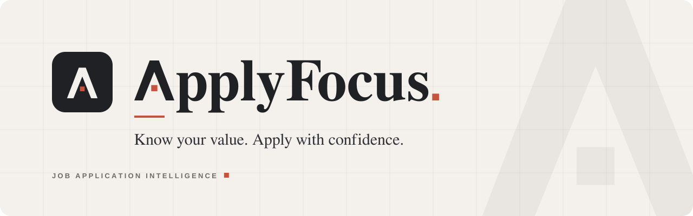
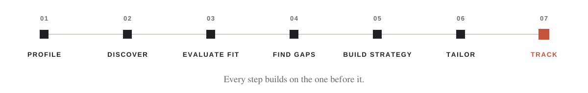

<picture>
  <source media="(prefers-color-scheme: dark)" srcset=".github/assets/banner-dark.svg">
  
</picture>

  
  
  

  A smarter way to navigate your job search. Understand your strengths, discover relevant opportunities, and turn your experience into stronger applications.

  <a href="#the-problem"><strong>The Problem</strong></a> &nbsp;·&nbsp;
  <a href="#what-is-applyfocus"><strong>What It Is</strong></a> &nbsp;·&nbsp;
  <a href="#how-applyfocus-helps"><strong>How It Helps</strong></a> &nbsp;·&nbsp;
  <a href="#the-applyfocus-experience"><strong>The Experience</strong></a> &nbsp;·&nbsp;
  <a href="#who-is-applyfocus-for"><strong>Who It's For</strong></a> &nbsp;·&nbsp;
  <a href="#our-vision"><strong>Vision</strong></a>

<picture>
  <source media="(prefers-color-scheme: dark)" srcset=".github/assets/divider-dark.svg">
  
</picture>

## At a glance

<table>
  <tr>
    <td width="33%" valign="top">  <strong>Profile</strong> Turn your resume and experience into a structured professional profile.</td>
    <td width="33%" valign="top">  <strong>Discover</strong> Find opportunities that make sense for your real background.</td>
    <td width="33%" valign="top">  <strong>Fit</strong> See strengths, evidence and gaps before you invest your time.</td>
  </tr>
  <tr>
    <td valign="top">  <strong>Strategy</strong> Know how to position yourself and what to prepare next.</td>
    <td valign="top">  <strong>Documents</strong> Tailored resumes and cover letters grounded in your evidence.</td>
    <td valign="top">  <strong>Tracking</strong> Keep every application, question and follow-up in one place.</td>
  </tr>
</table>

<picture>
  <source media="(prefers-color-scheme: dark)" srcset=".github/assets/divider-dark.svg">
  
</picture>

## The Problem

Finding a job has become a job of its own.

Candidates search across platforms, open hundreds of job descriptions, compare requirements, modify resumes, write cover letters, and track applications.

Yet, before applying, most candidates are still left with the same questions:

- Am I actually qualified for this role?
- Does my experience match what the company needs?
- What makes me a suitable candidate?
- What skills or experience am I missing?
- How should I present myself for this opportunity?
- Is this application worth my time?

Most job platforms help candidates find vacancies. Resume tools help them improve documents. Application trackers help them organize submissions.

But candidates still have to connect all the pieces themselves.

**ApplyFocus brings those decisions together.**

<picture>
  <source media="(prefers-color-scheme: dark)" srcset=".github/assets/divider-dark.svg">
  
</picture>

## What is ApplyFocus?

ApplyFocus is a candidate-first job search and application intelligence platform.

It helps candidates understand their professional profile, evaluate job opportunities, recognize their strengths and gaps, prepare tailored application materials, and manage their application journey.

Instead of treating every job as another application to submit, ApplyFocus helps candidates understand the opportunity before investing their time in it.

The goal isn't to apply to more jobs.

**It's to make every application more intentional.**

<picture>
  <source media="(prefers-color-scheme: dark)" srcset=".github/assets/divider-dark.svg">
  
</picture>

## How ApplyFocus Helps

### &nbsp; 01 · Understand Your Professional Value

Your experience is more than a list of job titles and skills.

ApplyFocus helps you build a structured professional profile from your resume, experience, skills, and projects.

- Build your professional profile.
- Extract relevant information from your resume.
- Review and confirm your information.
- Organize your skills, experience, and projects.
- Establish a clearer picture of your professional strengths.

Your profile becomes the foundation for evaluating opportunities.

### &nbsp; 02 · Discover Opportunities That Matter

Not every job deserves your attention.

ApplyFocus helps you explore job opportunities and understand how they relate to your professional background.

Rather than relying only on job titles or keyword overlap, the goal is to identify opportunities that make sense for your actual experience and capabilities.

Spend less time looking at irrelevant vacancies and more time evaluating meaningful opportunities.

### &nbsp; 03 · Understand Your Fit Before Applying

A matching percentage alone doesn't tell you whether you should apply.

ApplyFocus helps break down your suitability for an opportunity.

Understand:

- **Your strengths:** Skills and experience that support your application.
- **Your evidence:** Relevant experience and projects that demonstrate your capabilities.
- **Your gaps:** Requirements that your current profile does not establish.
- **Transferable skills:** Existing capabilities that may apply to different requirements.
- **Job expectations:** The responsibilities, qualifications, and skills the employer is looking for.

Get a clearer picture of where you stand before deciding what to do next.

### &nbsp; 04 · Build an Application Strategy

Knowing that a job matches your profile is only the beginning.

You also need to know how to approach the application.

ApplyFocus helps you understand:

- How to position your experience for the role.
- Which strengths deserve more attention.
- Which experience or projects provide the strongest support.
- Where your application has evidence gaps.
- What you should prepare for potential screening questions.
- What your next step should be.

The objective is to help you communicate your actual value, not manufacture qualifications you don't have.

### &nbsp; 05 · Prepare Better Resumes and Cover Letters

Your application should communicate why you're relevant to a particular opportunity.

ApplyFocus helps you create tailored application materials based on your professional profile and the job you're pursuing.

- Tailor your resume headline and professional summary.
- Improve the presentation of relevant experience.
- Align your application with the opportunity.
- Identify missing keywords and requirements.
- Compare original and tailored content.
- Prepare a role-specific cover letter.
- Preview and save your documents as PDFs.

Your experience remains yours. The goal is to present it more effectively.

### &nbsp; 06 · Stay Organized Throughout Your Job Search

A job search involves more than submitting applications.

Keep track of your progress and important next steps.

- Organize applications by status.
- Monitor application readiness.
- Keep track of screening questions.
- Manage follow-up reminders.
- Maintain visibility across your job search.

Spend less energy remembering what happened and more energy preparing for what comes next.

<picture>
  <source media="(prefers-color-scheme: dark)" srcset=".github/assets/divider-dark.svg">
  
</picture>

## The ApplyFocus Experience

<picture>
  <source media="(prefers-color-scheme: dark)" srcset=".github/assets/journey-dark.svg">
  
</picture>

Every step builds on the previous one.

Your professional profile informs your job evaluation. Your job evaluation informs your application strategy. Your strategy guides your resume and cover letter.

It's one connected experience rather than a collection of disconnected tools.

<picture>
  <source media="(prefers-color-scheme: dark)" srcset=".github/assets/divider-dark.svg">
  
</picture>

## Who Is ApplyFocus For?

ApplyFocus is designed for people who want to approach their job search with greater clarity and confidence.

- **Students and fresh graduates** navigating their first serious job search.
- **Early-career professionals** trying to find opportunities that match their growing experience.
- **Experienced professionals** exploring new roles or career transitions.
- **Career switchers** learning how their existing skills transfer to different opportunities.
- **Active job seekers** who want to spend their time on better-prepared applications.

Whether you're applying for your first job or your next career opportunity, understanding your value matters.

## What Makes ApplyFocus Different?

We believe job searching should start with the candidate, not the vacancy.

Most tools focus on individual tasks: finding jobs, checking keywords, generating resumes, or tracking applications.

ApplyFocus takes a different approach.

**Understand before you apply.**

A candidate should know why an opportunity makes sense before spending time on an application.

**Evidence over empty claims.**

Your skills and experience should be supported by information from your actual professional background.

**Clarity over complexity.**

You shouldn't need to understand complicated scores or technical terminology to make a career decision.

**Quality over quantity.**

The objective isn't to maximize the number of applications. It's to help candidates make better decisions and submit stronger applications.

**One continuous journey.**

Your profile, job evaluation, application strategy, documents, and progress should work together.

<picture>
  <source media="(prefers-color-scheme: dark)" srcset=".github/assets/divider-dark.svg">
  
</picture>

## Our Vision

We believe candidates deserve more than another tool that tells them to apply to more jobs.

They deserve to understand their professional value, recognize opportunities that make sense, and present themselves with confidence.

ApplyFocus aims to become the intelligent companion throughout that journey — from understanding who you are professionally to preparing for the opportunities ahead.

**Your career deserves better decisions.**

<picture>
  <source media="(prefers-color-scheme: dark)" srcset=".github/assets/divider-dark.svg">
  
</picture>

<picture>
  <source media="(prefers-color-scheme: dark)" srcset=".github/assets/footer-dark.svg">
  
</picture>

